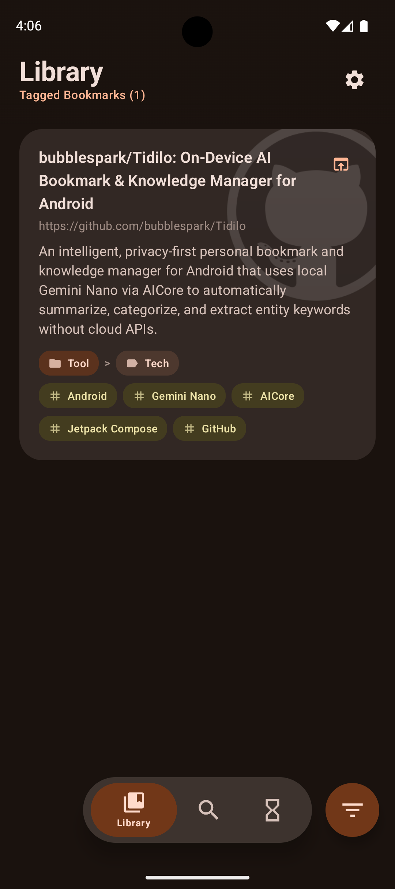
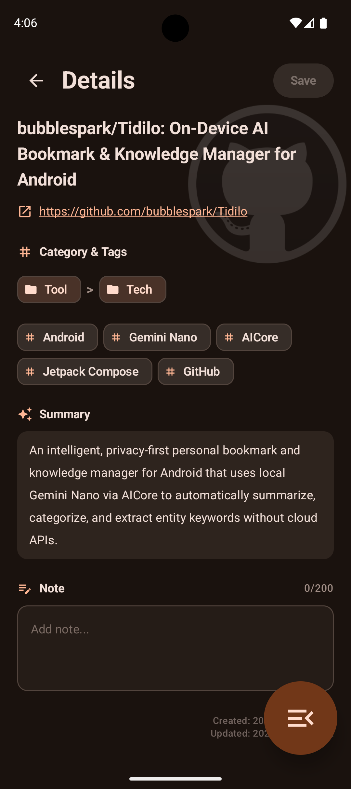
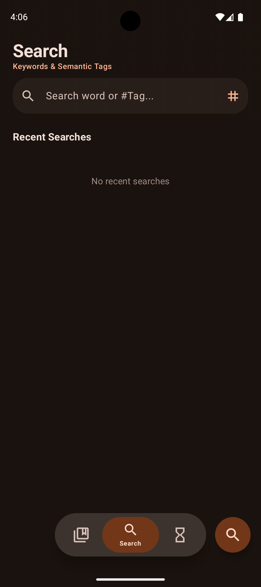
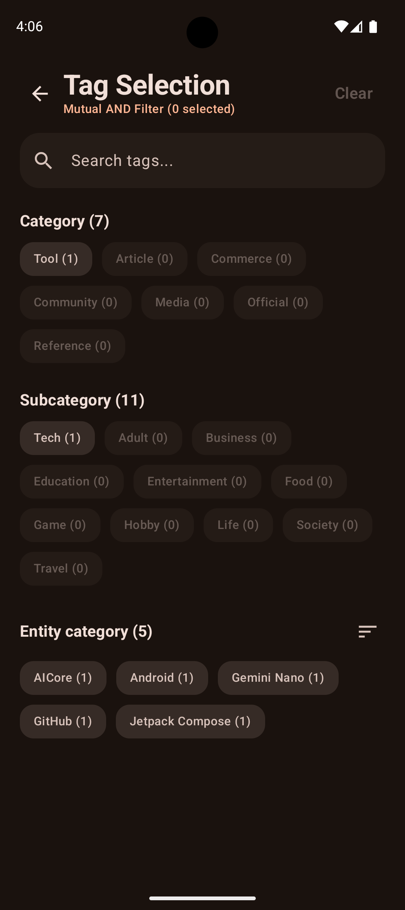

# Tidilo

<p align="center">
  <strong>Next-Generation On-Device AI Bookmark & Knowledge Manager for Android</strong>
</p>

<p align="center">
  
  
  
  
  
  
</p>

<p align="center">
  
  
  
  
</p>

---

## 🌟 Overview

**Tidilo** is an intelligent, privacy-first personal bookmark manager designed for modern Android. 

Instead of requiring manual organization, tedious tagging, or cloud-based categorization, Tidilo brings **Google Gemini Nano** directly onto your device via the Android system **AICore** service. When you share a web link from Chrome or any other browser, Tidilo fetches the content, cleans up boilerplate elements, and uses local on-device AI to synthesize an objective summary, categorize the topic, and extract entity keywords—**without sending any browsing data to external servers or cloud APIs.**

---

## ✨ Key Features

### 🧠 100% On-Device AI (Gemini Nano via AICore)
- **Zero API Keys Required**: Binds directly to Android's built-in `AICore` system service using the ML Kit GenAI Prompt SDK.
- **Complete Privacy & Offline Ready**: No user URLs, article texts, or metadata ever leave your smartphone.
- **Instant Processing**: Hardware-accelerated NPU inference with minimal battery and memory overhead.

### 🏷️ Intelligent Automated Tagging & Taxonomy
- **One-Sentence Synthesis**: Automatically crafts a concise, objective summary of the page content.
- **Two-Tier Structured Classification**:
  - **7 Categories**: `Article`, `Media`, `Tool`, `Commerce`, `Community`, `Official`, `Reference`
  - **11 Subcategories**: `Tech`, `Business`, `Society`, `Life`, `Food`, `Travel`, `Game`, `Entertainment`, `Hobby`, `Adult`, `Education`
- **Canonical Entity Extraction**: Extracts 2–10 high-precision keywords (brand names, software libraries, tools, frameworks) while filtering out ephemeral noise (years, buzzwords, generic modifiers).

### ⚡ Seamless Sharing & Background Ingestion
- **Transparent Share Sheet Receiver**: Share URLs directly from any Android app. Tidilo receives links in the background with zero screen flickering.
- **Semantic Content Extraction**: Uses **Jsoup** and **Readability4J** (Mozilla Firefox Readability engine) to eliminate ads, navigation bars, and cookie banners, extracting the pure article body and OGP metadata.

### 🎨 Material 3 Expressive UI
- **Modern Fluid Design**: Built 100% in Jetpack Compose, featuring expressive rounded shapes (20–28dp), fluid spring physics, and dynamic color theming.
- **Immersive Edge-to-Edge**: Full edge-to-edge layout with translucent frosted headers, subtle domain ambient lighting, and smooth navigation.
- **Domain Deck View**: Visual grouped cards and domain-level drill-down for rapid navigation across collections.

### 🗄️ Robust Offline-First Persistence
- **Room SQLite Architecture**: High-speed, ACID-compliant local database storing bookmarks and trash records with sub-millisecond indexed search.
- **Reactive State Flow**: In-memory `StateFlow` caching provides instantaneous UI responsiveness (0ms perceived latency).
- **Trash & Undo System**: Accidental deletions can be immediately undone with a single tap.
- **NSFW Content Isolation**: Dedicated privacy filters and blurred previews for sensitive content.

---

## 🛠️ Architecture & Tech Stack

Tidilo adheres to modern Android architecture best practices with **Unidirectional Data Flow (UDF)**:

- **Language & Runtime**: Kotlin 2.4.2 on Java 21
- **UI Framework**: Jetpack Compose BOM 2026.09.00 with Material 3 Expressive components
- **Navigation**: Navigation Compose 2.10.2 with type-safe routing
- **Concurrency**: Kotlin Coroutines & Reactive `StateFlow`
- **Database**: AndroidX Room 2.8.5 with KSP
- **On-Device AI**: `com.google.mlkit:genai-prompt:1.0.0-beta2` (Gemini Nano on Android AICore)
- **Web Parsing**: Jsoup 1.18.3 & Readability4J 1.0.8

---

## 📱 Hardware & OS Requirements

- **Operating System**: Android 14 (API 34) or higher
- **Target Hardware**: In addition to supporting AICore, you must also support the **Prompt API** for the ML Kit GenAI API. Please see [here](https://developers.google.com/ml-kit/genai?hl=ja#prompt-device) for a list of devices that support AICore.

---

## 🚀 Getting Started

### Building from Source

1. **Clone the repository**:
   ```bash
   git clone https://github.com/your-username/tidilo.git
   cd tidilo
   ```

2. **Open in Android Studio**:
   - Recommended: Android Studio Ladybug (2024.2) or newer.
   - JDK: Java 21.

3. **Build & Run Tests**:
   ```bash
   # Run unit tests
   ./gradlew testDebugUnitTest

   # Assemble debug APK
   ./gradlew assembleDebug
   ```

4. **Install on Device**:
   ```bash
   ./gradlew installDebug
   ```

---

## ⚠️ Precautions for Use

### AICore Usage Limit
- **AICore has an allocation limit**: Although it works in a local environment, AICore has certain usage limits. If you reach these limits, your access may be restricted for 24 hours. 
- **An Approach to Limitations on the Application Side**: There are no specific restrictions. However, if this error occurs, a dialog box will appear on the screen. Any imports currently in progress will be rolled back to their previous state.
- **Proposed Solutions to This Limitation**: When you import URLs, they accumulate before being processed by the AI. You should run AI analysis periodically to prevent them from piling up. There’s also an option to run this automatically when you launch the app, so please take advantage of it.

---

## 🔒 Privacy Philosophy

Your bookmarks represent your thoughts, interests, and personal knowledge. Tidilo is built on the principle that personal organization tools should never compromise privacy:
- **No analytics or tracking SDKs.**
- **No remote server synchronization.**
- **No cloud LLM API calls.**

All AI inference, metadata parsing, and database transactions remain exclusively on your device.

---

## 📄 License

This project is licensed under the Apache License 2.0 - see the [LICENSE](LICENSE) file for details.
