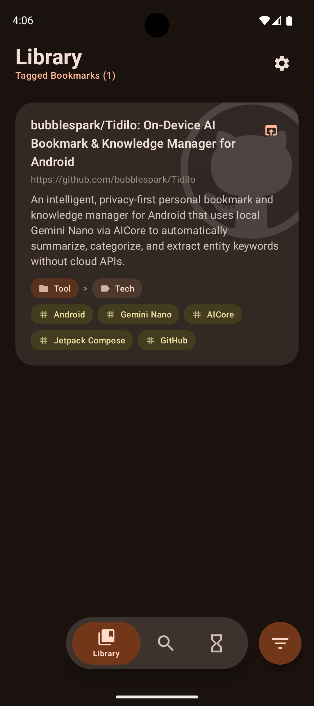
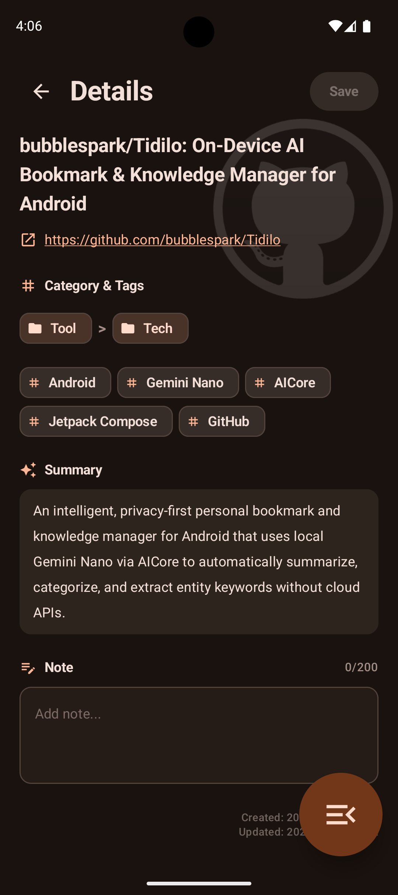
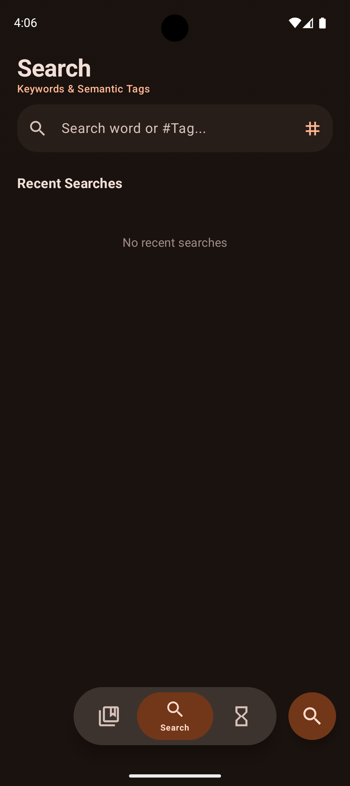
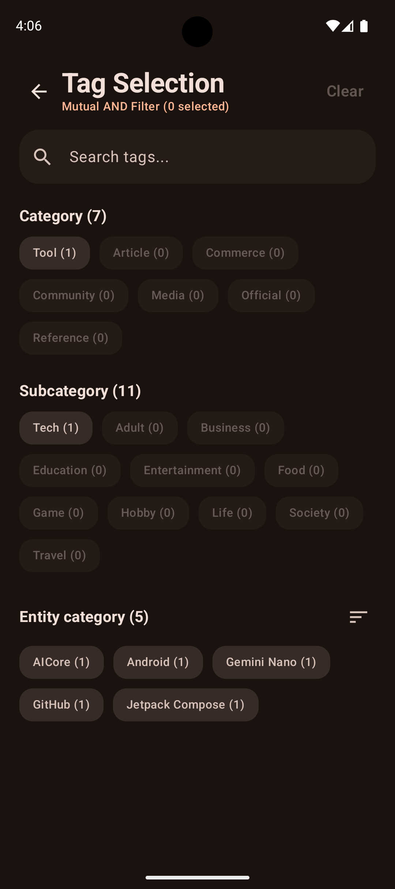

# Tidilo

  <strong>A local-first bookmark and RSS manager for Android, with optional on-device AI.</strong>

  
  

  
  
  
  

---

## Overview

**Tidilo** keeps the pages you want to come back to. Share a link from any app, or subscribe to a feed, and Tidilo saves the title, description and preview image into a library that lives on your device.

AI tagging is optional. Everything below works without it.

---

## Features

### Save
- **Share from anywhere**: Send a URL from Chrome or any app through the Android share sheet. Tidilo saves it in the background.
- **Clean page details**: Tidilo fetches the page and picks up its title, description, preview image and site icon.

### Follow feeds
- **RSS and Atom subscriptions**: Subscribe to your favorite sites and get new articles in your library.
- **Daily fetch**: Pick up to three fetch times per day, and choose to fetch over Wi-Fi only.
- **Fetch now**: Pull the latest items whenever you like.

### Find and organize
- **Library**: Browse by tag or by domain, and group cards by site.
- **Search**: Look up bookmarks by title, summary, tag or domain.
- **Tags**: Organize with tags that you add or edit yourself.
- **Trash and undo**: Undo an accidental deletion with one tap.
- **Content safety**: Sensitive content can be hidden or blurred.
- **Storage dashboard**: See and manage the cached images and icons.

### Material 3 Expressive design
- Edge-to-edge layout, dynamic color and fluid motion.

---

## Optional AI Analysis

On supported devices, Tidilo can analyze saved pages with **Gemini Nano** through Android's AICore.

- **Summary**: A short, objective summary of the page.
- **Category**: One of 7 categories and one of 11 subcategories.
- **Keywords**: Canonical keywords such as product, tool and brand names.

Turn it off in **Settings** and Tidilo saves bookmarks directly, using the page's own description as the summary.

> [!NOTE]
> AICore limits how much each app can run. If you reach the limit, analysis pauses for a while. Pending items wait in the Import queue, and you can run the analysis later or on app launch.

---

## Privacy

Your library is yours. Tidilo is local-first:

- **Data stays on your device.** Bookmarks, tags, summaries and your reading activity are stored locally.
- **No analytics or tracking SDKs.** Tidilo has no account and no sync server.
- **AI runs on-device by default.** Gemini Nano does the analysis, so page text is not sent to a cloud service.
- **Network use is limited to what you ask for.** Tidilo connects only to the pages you save and the feeds you subscribe to. Browsing your saved library works without a connection.

---

## Roadmap

These are plans, not promises, and may change.

- **Personalization**: Use your reading activity to surface what matters to you. This data would stay on your device.
- **Cloud AI (opt-in)**: Bring your own API key to use an external AI model on devices without AICore. It would be off by default, and it would send page content only when you enable it.

---

## Requirements

- **Android 14 (API 34) or higher**
- **For AI Analysis**: A device that supports AICore and the ML Kit GenAI Prompt API. See the [supported devices](https://developers.google.com/ml-kit/genai#prompt-device).

---

## For Developers

Architecture, conventions and specifications are in [docs/README.md](docs/README.md).

---

## License

Apache License 2.0. See [LICENSE](LICENSE).
