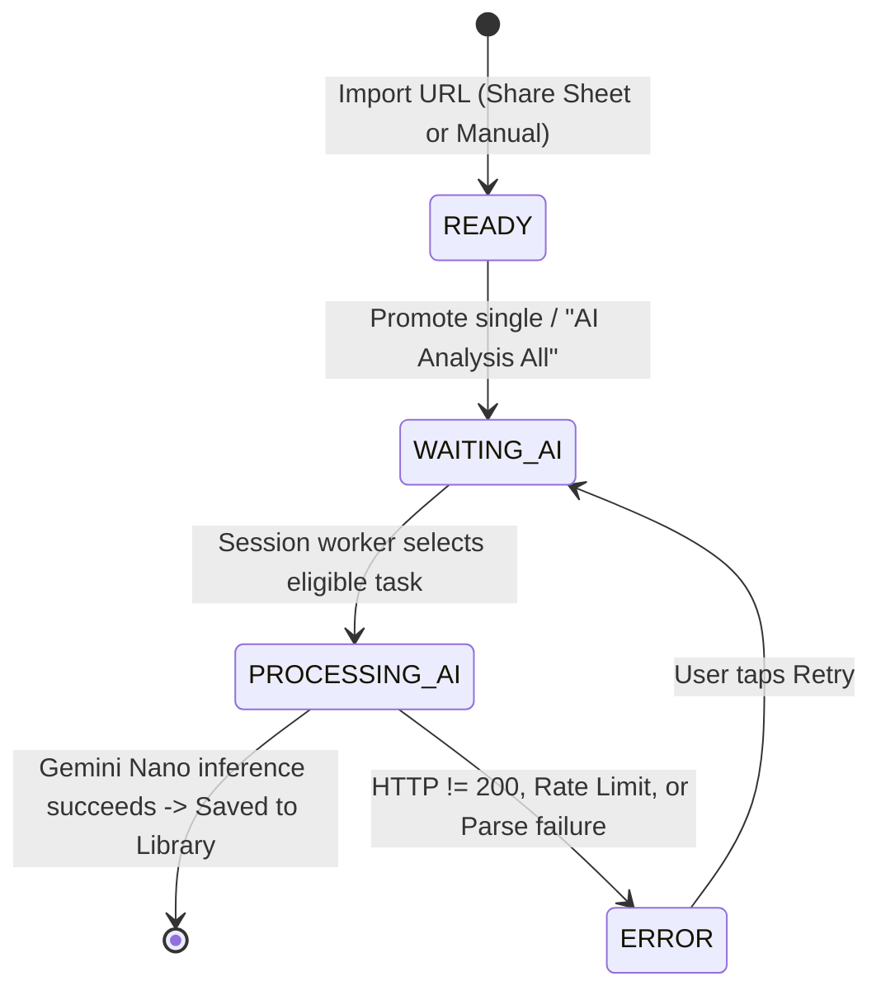
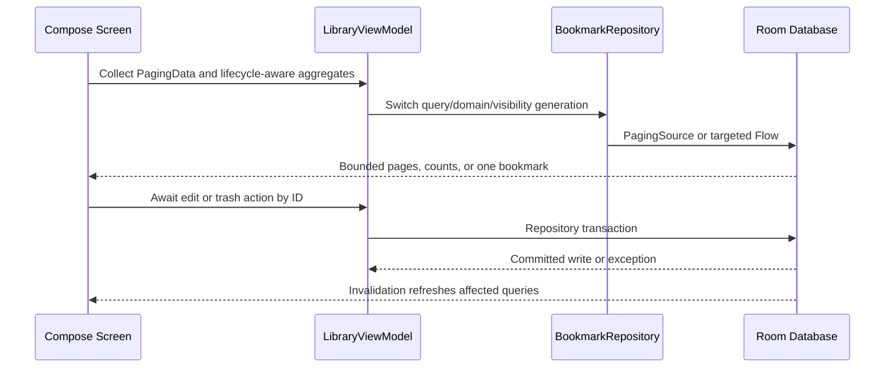

# Data Models, State Flows, & Persistence Interfaces

Room 13 adds local RSS notification run/item accounting, including atomic article outcomes and completion-time Ready snapshots. `MIGRATION_12_13` preserves all existing bookmark, subscription, queue, and in-app notification tables. See [Android OS Notifications](notifications.md).

This document specifies all core domain models, state transition machines, serialization schemas, and reactive data streams used throughout Tidilo.

---

## 1. Domain Data Models

`parser/ParsedWebPage` is a transient extraction result, separate from persisted bookmarks and queue items. It retains the original `readabilityArticle` for inspection and a nullable `cleanedBodyText` for the full ad-filtered Readability/Jsoup result. `promptBodyText` selects that cleaned result, including an intentionally empty result; only legacy callers without it use the original Readability/Jsoup fallback. Debug displays the full body, while ArticlePreparation truncates it to the existing 800-character snippet. No database migration is required.

### 1.1 `BookmarkItem` & `Tag`
Located in `ui/screens/library/BookmarkItem.kt`:

```kotlin
@Immutable
data class BookmarkItem(
    val id: String = UUID.randomUUID().toString(),
    val title: String,
    val url: String,
    val description: String,
    val tag: Tag = Tag(),
    val createdAt: Long = System.currentTimeMillis(),
    val updatedAt: Long = System.currentTimeMillis(),
    val note: String = "",
    val isNsfw: Boolean = false,
    val isAiSkipped: Boolean = false,
    val ogImageUrl: String? = null,
    val rssFeedId: String? = null,
    val rssPublishedAt: Long? = null,
    val domain: String? = DomainIconManager.extractDomain(url),
    val ogImageFilename: String? = ogImageUrl?.takeIf { it.isNotBlank() }?.let { ogUrl ->
        val resolved = OgImageManager.resolveImageUrl(url, ogUrl)
        OgImageManager.computeImageKey(resolved)
    }
)

@Immutable
data class Tag(
    val category: String? = DEFAULT_TAG,       // 1 of 7 Top-Level Categories, "None", or null (when AI is skipped)
    val subcategory: String? = DEFAULT_TAG,    // 1 of 11 Subcategories, "None", or null (when AI is skipped)
    val entities: List<String> = emptyList()   // Keyword strings
) {
    companion object {
        const val DEFAULT_TAG = "None"
        const val MAX_ENTITIES = EntityTagPolicy.MAX_ENTITIES
        fun create(category: String?, subcategory: String?, entities: List<String> = emptyList()): Tag
        fun createEmpty(): Tag = Tag(category = null, subcategory = null, entities = emptyList())
        fun addEntity(current: List<String>, newEntity: String): List<String>
        fun toggleEntity(current: List<String>, entity: String): List<String>
    }
}
```

### 1.2 `EntityTagPolicy`
Managed in `data/EntityTagPolicy.kt`:

Shared non-UI policy for normalizing, deduplicating, and bounding entity tags across parser, ingestion, and UI layers:
- Trims whitespace and strips a single leading `#` prefix.
- Ignores blank entries.
- Deduplicates tags case-insensitively while preserving insertion order and the original casing of the first encountered occurrence.
- Caps the maximum number of tags at `MAX_ENTITIES` (10).
- `Tag.addEntity`, `Tag.toggleEntity`, and `Tag.MAX_ENTITIES` delegate directly to `EntityTagPolicy`.


### 1.3 `TrashedBookmarkItem`
Located in `ui/screens/library/BookmarkItem.kt`:

```kotlin
@Immutable
data class TrashedBookmarkItem(
    val bookmark: BookmarkItem,
    val trashedAt: Long = System.currentTimeMillis()
)
```

### 1.4 Disposable Image Caching & URL-Distinct Identity (`cacheDir`)
Managed in `data/OgImageManager.kt` and `data/DomainIconManager.kt`:

#### Trash Retention & Lifecycle Rules
- **Physical Exclusion**: Trashed items are physically excluded from normal bookmarks list, search feeds, and category queries.
- **Persistence**: Serialized to `trashed_bookmarks_list` in `tidilo_bookmark_prefs.xml`.
- **Retention Period**: Kept for 30 days (`TRASH_RETENTION_MS = 30 * 24 * 60 * 60 * 1000L`). Expired items are purged on application launch (`purgeExpiredTrash()`).
- **Maximum Capacity**: Capped at 100 items (`MAX_TRASH_CAPACITY = 100`). When a 101st item is trashed, the oldest item (closest to the 30-day limit) is permanently deleted automatically.

#### Self-Repair Guarantee
If old or corrupted JSON data lacks valid category/subcategory tags, `BookmarkRepository.parseBookmarks` automatically restores them using fallback sample references, queue completion cache, or domain mapping rules to guarantee no item permanently remains `None`.

---

## 2. Taxonomy System

Located in `data/Taxonomy.kt`:

### 2.1 The 7 Top-Level Categories
| ID | Definition |
| :--- | :--- | :--- |
| `Article` | Articles, blog posts, editorials, news, technical explainers, opinions. |
| `Media` | Illustrations, photos, video content, music, audiobooks (Pixiv, YouTube, Vimeo). |
| `Tool` | Web applications, utilities, SaaS, code repositories, productivity tools (GitHub, Figma). |
| `Commerce` | E-commerce, online shops, product sales, pricing pages (Amazon, online stores). |
| `Community` | Social networks, forums, Q&A boards, online communities (X/Twitter, Reddit, Discord). |
| `Official` | Official portals, corporate homepages, brand landings. |
| `Reference` | Technical documentation, API references, dictionaries, wikis, standards (MDN, Android Docs). |

### 2.2 The 11 Subcategories
| ID |
| :--- |
| `Tech` |
| `Business` |
| `Society` |
| `Life` |
| `Food` |
| `Travel` |
| `Game` |
| `Entertainment` |
| `Hobby` |
| `Adult` |
| `Education` |

Both `Category` and `Subcategory` provide bidirectional constant-time $O(1)$ resolution via `fromId(query)` backed by pre-computed case-insensitive `LOOKUP_MAP` tables matching against canonical IDs and localized labels.

---

## 3. Import Task State Machine & Models

Located in `data/ImportTask.kt`:

```kotlin
enum class TaskStatus {
    PROCESSING_AI, // Active inference running on Gemini Nano
    WAITING_AI,    // Waiting in Processing group for AICore execution slot
    READY,         // URL parsed and ready for AI analysis (share sheet or '+' button)
    COMPLETED,     // Finished tagging and saved into BookmarkRepository
    ERROR          // Failed due to rate limit, non-200 HTTP response, or parse failure
}

@Immutable
data class ImportingTask(
    val id: String = UUID.randomUUID().toString(),
    val url: String,
    val title: String? = null,
    val createdAt: Long = System.currentTimeMillis()
)

@Immutable
data class ImportTask(
    val id: String = UUID.randomUUID().toString(),
    val url: String,
    val title: String,
    val status: TaskStatus = TaskStatus.READY,
    val statusText: String = "",
    val errorMessage: String? = null,
    val assignedTags: List<String> = emptyList(),
    val createdAt: Long = System.currentTimeMillis(),
    val isNsfw: Boolean = false,
    val siteName: String = "",
    val description: String = "",
    val bodySnippet: String = "",
    val ogImageUrl: String? = null
)
```

### 3.1 State Transition Lifecycle



---

## 4. Web Page Analysis Models

Located in `parser/WebPageData.kt`:

- `ParsedWebPage`: Comprehensive snapshot including `requestedUrl`, `finalUrl`, `resolvedUrl` (unwrapped Google share link), `statusCode`, `ogpTags`, `twitterTags`, `standardMetaTags`, `jsonLdList`, `h1List`, `h2List`, `readabilityArticle`, and `jsoupBodyText`.
- `WebMetaTag`: Generic key-value wrapper for meta attributes (`charset`, `name`, `property`, `http-equiv`, `itemprop`).
- `JsonLdItem`: Structured Schema.org entity metadata.
- `ExtractedArticle`: Cleaned article content from Mozilla Readability algorithm (`title`, `byline`, `excerpt`, `textContent`, `charCount`).

---

## 5. Gemini Generation Configuration Model

Located in `ui/screens/settings/GenerateContentRequestViewModel.kt`:

Controls runtime LLM generation options passed to `com.google.mlkit.genai.prompt.generateContentRequest`:
- `cachedContextName` (`String`, default `""` / disabled)
- `candidateCount` (`Int`, default `1`, enabled)
- `enableThinking` (`Boolean`, default `false` / disabled)
- `maxOutputTokens` (`Int`, default `4096`, disabled; overridden to `256` in tagging pipeline)
- `seed` (`Int`, default `0` / disabled)
- `temperature` (`Float`, range `0.0f..1.0f` in `0.1` steps, default `0.0f`, enabled)
- `topK` (`Int`, default `3` / disabled)

---

## 6. Persistence & Serialization Schemas

All persistence is managed via **Room Database** (`AppDatabase` v12) for robust relational and high-volume data, complemented by Android `SharedPreferences` for user configurations and transient search history:

1. **Room Database (`AppDatabase`)**:
   - **`bookmarks` table (`BookmarkEntity`)**: Managed by `BookmarkDao`, storing bookmarked items with indexed URL, creation timestamp, `domain`, and `ogImageUrl` / `ogImageKey` linking to specific cached OG image assets. Bulk writes (`insertAll`) execute in chunked batches of 500 with per-chunk ID deduplication.
   - **`trashed_bookmarks` table (`TrashedBookmarkEntity`)**: Managed by `TrashDao`, storing trashed items with retention tracking and `ogImageUrl`.
   - **`import_tasks` table (`ImportTaskEntity`)**: Managed by `ImportTaskDao`, storing processing, ready, and error tasks with reactive `Flow<List<ImportTaskEntity>>` observation and status index.
   - **Safe Migration & Database Decoupling (v6)**: In version 6, obsolete image BLOB storage (`og_images` table) was cleanly dropped via `MIGRATION_5_6`, liberating database file size while preserving 100% of bookmark, tag, and note data.
   - **Awaited Import Persistence**: Normal and fallback import results await `addBookmarkAndAwait`, which replaces bookmarks by ID or URL inside a Room transaction. Import tasks are deleted only after bookmark persistence succeeds. Fallback persistence failures retain the task in Error for retry. Bookmark persistence and import-task deletion are separate operations; an interruption between them can retain both records, but cannot delete the only durable copy. URL-based replacement makes a repeated save replace the same URL.
   - **Single Source of Truth & Concurrency**: Room DB serves as the authoritative source of truth for all business operations, state promotions, and the single AI session worker. UI StateFlows (`_readyTasks`, `_processingTasks`, `_errorTasks`) are read-only observers of Room. The worker holds `executionMutex` for the session, queries Room directly for runnable tasks, and awaits task and batch state updates before selecting more work. It rechecks each selected task after model initialization to skip tasks that have been deleted or are no longer runnable. Retry deadlines are transient in-memory state; background and interrupted tasks remain persisted for foreground resume.
2. **`tidilo_library_prefs` (`search_history`)**:
   Array of up to 10 strings representing complete queries, ordered latest-first.
3. **`tidilo_app_config_prefs`**:
   Application language, NSFW visibility toggle, AICore fallback mode, and auto-run settings.

---

## 7. Reactive StateFlow Architecture



---

## 8. Domain Policy & NSFW Architecture

### 8.1 `DomainPolicyManager`
Located in `data/DomainPolicyManager.kt`:
- **Persistence**: Persisted to `domain_policies.json` in `filesDir`.
- **Policy Record**: `DomainPolicy(domain: String, isNsfw: Boolean, displayName: String = "")`.
- **Display Name (`og:site_name`)**: Extracted from page HTML meta tags (`og:site_name`) during web page parsing or favicon discovery (`DomainIconManager.findHtmlIconUrls`), and stored as the human-readable display name for the domain.
- **Auto-Registration**: When new domains are enqueued or bookmarked, they are automatically registered with `isNsfw = false` and their display name if available.
- **Domain Verification**: Checked domains are designated as NSFW domains. Any bookmark from a checked domain is tagged as `isNsfw = true`.

### 8.2 NSFW Detection Signals (`WebPageParser.kt`)
Web page fetching uses Desktop Chrome User-Agent (`Windows NT 10.0; Win64; x64`, `sec-ch-ua-mobile: ?0`) to ensure platforms like Pixiv return complete desktop SSR HTML with standard metadata rather than stripped mobile touch SPAs. Programmatic detection extracts:
1. **Domain NSFW Policy (`DomainPolicyManager.isNsfwDomain(domain)`)**: If designated as NSFW in domain management, NSFW is unconditionally granted (`isNsfwSignal = true`) regardless of tags or metadata.
2. **Title / OGP Title Keywords**: `"R-18"`, `"R18"`, and localized adult rating terms.
3. **Meta Rating Standards (`<meta name="rating">`)**: `"R-18"`, `"R18"`, `"18+"`, `"RTA-5042-1996-1400-1577-RTA"`, `"adult"`, `"mature"`
4. **Schema.org / JSON-LD Properties**:
   - `isFamilyFriendly: false`
   - `contentRating`: `"R18"`, `"R-18"`, `"18+"`
   - `typicalAgeRange`: `"18+"`

### 8.3 Display Control & Dynamic Count Aggregation
- **Global Toggle**: `AppConfig.isNsfwContentVisible` (persisted in `tidilo_app_config_prefs`).
- **Reactive Filter**: `AppConfig.isNsfwContentVisible` switches Paging generations and SQL aggregate queries. NSFW filtering happens in SQLite before paging or counting, including all tag-selection candidates.
- **Visual Badge**: Both `BookmarkCard` and `BookmarkDetailScreen` render a prominent `NSFW` pill chip beside the `[category] > [subcategory]` breadcrumb when `bookmark.isNsfw == true`.

---

## 9. Library Filter & Domain Grouping Models

Located in `ui/screens/library/DomainCard.kt` and `ui/screens/library/LibraryViewModel.kt`:

### 9.1 `LibraryFilterMode`
```kotlin
enum class LibraryFilterMode {
    NEWEST_FIRST,
    DOMAIN
}
```
Persisted in `tidilo_library_prefs.xml` under key `library_filter_mode`.

### 9.2 `DomainGroupItem`
```kotlin
@Immutable
data class DomainGroupItem(
    val domain: String,
    val displayName: String,
    val count: Int
)
```
- **Sorting Rule**: Sorted by `displayName` (fallback to `domain` if empty). ASCII alphanumeric (A–Z, 0–9) characters are ordered first, followed by Japanese kana/kanji ordered via `Collator.getInstance(Locale.JAPANESE)`.


## Database v7 derived bookmark data

Active bookmarks carry nullable `domain` plus Unicode comparison keys for title,
description, URL, category, and subcategory. `BookmarkEntity.fromBookmarkItem`
and transactional DAO writes compute these fields with the existing domain
normalizer and `bookmarkSearchKey`. Original user fields remain unchanged.
`bookmark_entities` stores `(bookmarkId, position, value, searchValue)` with a
cascading foreign key, preserving duplicate entity occurrences and original-case
count buckets. Replacements, field/tag edits, and bulk writes refresh the child
rows transactionally; deletion cascades to those rows. Trash has no domain column.

`MIGRATION_6_7` adds the domain index and backfills only derived fields and child
rows in stable-ID batches of 256. It completes before Room readers are exposed.
Supported v1-v6 upgrade paths are registered explicitly; destructive fallback is
removed. Paging and aggregate queries apply NSFW filtering before fetching or
counting, and bookmark result order is `createdAt DESC, id DESC`. Entity matching
uses individual child values, never serialized JSON substrings.

The Repository has no eager active-bookmark collection. Timeline, domain results,
and search expose bounded PagingData; details observe one ID independently of
loaded pages. Domain/tag counts and settings use SQL aggregates. Page size is 30,
initial load 60, prefetch 10, max size 150, with placeholders disabled. Generations
switch with flatMapLatest before cachedIn(viewModelScope).

Derived tags mirror Tag.create, including null/blank defaults, leading # removal,
trimmed entity values, duplicate occurrences, and truly empty AI-skipped tags.
Original persisted fields remain untouched. Category/subcategory aggregate
buckets merge normalized spellings while preserving original case. Comparison
keys follow the running String ignoreCase implementation, including Android's
UTF-16 treatment of supplementary letters. The reserved SQLite application_id
marks the derived format; an onOpen transaction repairs an older prerelease
format once, before readers, without changing Room's user_version or raw fields.

Aggregate/trash reads wait for initialization. Failed reads publish a recoverable
state and restart on explicit retry. Trash moves and capacity enforcement share
one transaction. Domain NSFW changes await the SQL update and policy publication
in the application scope so navigating away cannot interrupt those two steps.

Domain policy failure handling: the domain-wide SQL flag update and policy-save
callback execute inside one Room transaction. A policy-file exception rolls back
each original flag automatically, including mixed values, without collecting all
bookmarks. The policy manager stages the proposed entry and publishes it only
after file persistence succeeds. Policy mutation/file-writing sections are
serialized; writes use a sibling temporary file and atomic replacement. The
operation retains application-scope ownership when its UI caller is cancelled.
Room and the JSON file still cannot provide a crash-atomic transaction across
stores: process death or a DB commit failure after a successful file replacement
is outside this handled policy-write failure boundary.


## Application Summary Statistics

`AiUsageSnapshot` contains local daily aggregates, recording start date, and the last quota benchmark. `DailyAiUsage` reconciles success, failed, cancelled, interrupted, and pending outcomes, with a debug subtotal. `AiCoreUsageRepository` commits a dedicated versioned SharedPreferences snapshot without content identifiers; abandoned pending records become interrupted after process restart. `CollectionCounts(active, trash)` is an observed atomic SQL projection, not a new table. `CacheStorageSnapshot` records physical category bytes, PNG/WebP counts, and measurement time. No Room migration is required. See [Application Summary](application_summary.md).

## RSS Source and Receipt Persistence

Room9 source fields, receipt transactions, indexed image references, queue claims, and count retention are specified in [RSS and Atom Subscriptions](rss.md). Manual records retain null RSS ownership; trash mappings and targeted bookmark edits preserve ownership and publication time. Source-aware Library queries use MANUAL or RSS; search/tag queries use ALL.

## Shared ingestion preparation (Room10)

Import tasks persist `articlePrepared`, `intendedMode`, `rssItemKey`, `acquisitionAttempts`, and `acquisitionRetryAt`. Nonblank XML content never proves HTML preparation. Failed/unprepared acquisition is not eligible for an AI claim; Direct acquisition retries remain Direct. Feed entities persist `acquisitionId`, `acquisitionMobileOverride`, `acquisitionXmlDone`, and `acquisitionRequestedAt` for interruption-safe continuation. `enabled=false` plus `error=XML_FETCH_FAILED` represents automatic disabling after a feed XML failure; disabling does not delete content or consumed receipts. Migration9-to10 preserves existing rows and configured retention.

## RSS feed metadata and library groups (Room12)

`RssFeedEntity.iconUrl` and `siteUrl` are nullable persisted HTTP(S) metadata added by `MIGRATION_11_12`, after the notification schema's unchanged `MIGRATION_10_11`. Migration 11 to 12 also supports the earlier RSS-only v11 development build: it creates the notification table/index if absent and adds only missing RSS metadata columns, preserving existing metadata and user data. Registration and 200 XML responses update metadata; 304 preserves it. `RssFeedGroup(feed, count)` is an observed SQL join/aggregate over rss_feeds and visible active bookmarks, including disabled/deleted subscriptions. Bookmark query builders accept an optional bound rssFeedId for both Paging results and counts. Feed grouping never materializes all bookmarks, and search/tag source scope remains unchanged. See [RSS and Atom Subscriptions](rss.md).

## Import Notifications and Duplicate Resolution (Room11)

Room version 11 introduces `import_notifications` for tracking duplicate import rejections, RSS article promotions, and import warnings:
- Table: `import_notifications` with fields `id` (INTEGER PRIMARY KEY AUTOINCREMENT), `type` (TEXT: `INFO`, `WARNING`, `ERROR`), `domain` (TEXT), `url` (TEXT), `message` (TEXT), `existingBookmarkId` (TEXT), `isRead` (INTEGER), and `createdAt` (INTEGER).
- Indexed on `createdAt DESC` for fast notification popup retrieval.
- DAO provides reactive flows `observeNotifications()` and `observeUnreadCount()`, plus `markAllAsRead()` and `deleteAll()`.
- Migration 10 to 11 preserves all existing tables and creates the `import_notifications` table and index.
