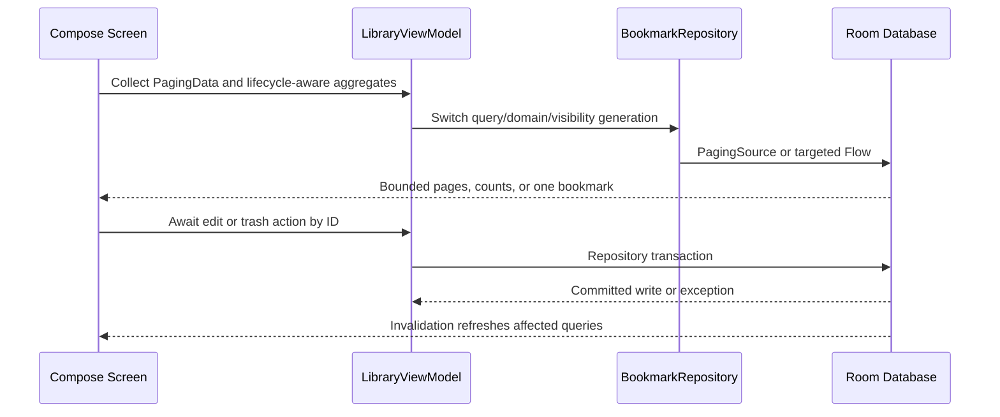

# Data Models, State Flows, & Persistence Interfaces

This document specifies Tidilo's core domain models, entity-tag normalization, import state machine, taxonomy, domain policies, reactive streams, and Room (`AppDatabase` v22) persistence contracts.

## Related Specifications
| Domain / Feature | Specification |
| :--- | :--- |
| **Trash & Duplicate Detection** | [trash.md](trash.md) |
| **Manual Collections** | [collections.md](collections.md) |
| **RSS/Atom Subscriptions & Maintenance** | [rss.md](rss.md), [library_maintenance.md](library_maintenance.md) |
| **Notifications & In-App History** | [notifications.md](notifications.md), [library_navigation.md](library_navigation.md) |
| **Standard Classification & Storage Stats** | [bookmark_classification.md](bookmark_classification.md), [application_summary.md](application_summary.md) |
| **Preview & Domain Icon Caches** | [og_image_cache.md](og_image_cache.md), [domain_icon_cache.md](domain_icon_cache.md) |

---

## 1. Domain Data Models

### 1.1 `BookmarkItem` & `Tag` (`ui/screens/library/BookmarkItem.kt`)

```kotlin
@Immutable
data class BookmarkItem(
    val id: String,
    val title: String,
    val url: String,
    val description: String,
    val tag: Tag,
    val createdAt: Long = System.currentTimeMillis(),
    val updatedAt: Long = createdAt,
    val note: String = "",
    val isPrivate: Boolean = false,
    val isLiked: Boolean = false,
    val browserOpenCount: Int = 0,
    val detailViewCount: Int = 0,
    val summaryPeekCount: Int = 0,
    val lastInteractedAt: Long? = null,
    val ogImageUrl: String? = null,
    val rssFeedId: String? = null,
    val rssPublishedAt: Long? = null,
    val domain: String? = DomainIconManager.extractDomain(url),
    val ogImageFilename: String? = ogImageUrl?.takeIf { it.isNotBlank() }?.let { ogUrl ->
        val resolved = OgImageManager.resolveImageUrl(url, ogUrl)
        OgImageManager.computeImageKey(resolved)
    }
)

@Immutable
data class Tag(
    val category: String? = DEFAULT_TAG,       // 1 of 7 Categories, "None", or null
    val subcategory: String? = DEFAULT_TAG,    // 1 of 11 Subcategories, "None", or null
    val entities: List<String> = emptyList()
) {
    companion object {
        const val DEFAULT_TAG = "None"
        const val MAX_ENTITIES = EntityTagPolicy.MAX_ENTITIES // 10
        fun create(category: String?, subcategory: String?, entities: List<String> = emptyList()): Tag
        fun fromDisplayValues(category: String?, subcategory: String?, entities: List<String> = emptyList()): Tag
        fun createEmpty(): Tag = Tag(category = null, subcategory = null, entities = emptyList())
        fun addEntity(current: List<String>, newEntity: String): List<String>
        fun toggleEntity(current: List<String>, entity: String): List<String>
    }
}
```
- **Engagement Contract**: Atomic updates increment `browserOpenCount`, `detailViewCount`, and `summaryPeekCount` and refresh `lastInteractedAt`; liking updates `lastInteractedAt`, while unliking preserves it. Edits, URL replacement, and RSS promotion preserve engagement fields; moving to/restoring from Trash sets `isLiked = false` while keeping counters and `lastInteractedAt`.

### 1.2 `EntityTagPolicy`, Canonical Identity & Suggestions (`data/EntityTagPolicy.kt`)
- **Cleaning & Skeleton Key**: `clean` trims whitespace and removes a single leading `#` (so raw `##C` becomes display `#C`, distinct from `C`, without double-stripping via `Tag.fromDisplayValues` or `toggleDisplayEntity`); blanks are dropped. `entitySkeletonKey` applies NFKC normalization and Unicode case folding, then removes whitespace, `.`, `_`, and `-` while keeping meaningful symbols (`+`, `#`). Caps at `MAX_ENTITIES = 10`.
- **Canonical Write Contract (`BookmarkDao`)**: All active bookmarks (including hidden Private rows) share one canonical display spelling per `skeletonKey`. `BookmarkDao` canonicalizes single writes, URL replacements (resolved before deleting the previous owner), 500-row bulk chunks (transaction-local key map), AI review, RSS ingestion, initial import, and Trash restoration, refreshing JSON and ordered `bookmark_entities` rows in one transaction. Note-only, Private-only, and RSS-ownership writes keep existing entities intact.
- **Detail Save & Conflict Lookup**: Detail Save applies staged skeleton replacements across all matching active bookmarks (bounded batches updating only entity JSON and `updatedAt`), overlays explicit draft choices (even if the last occurrence vanished), and commits note, tags, and Private state atomically with full rollback on failure. Substring search/counts continue using literal `searchValue`; conflict lookup queries all active entities regardless of Library source, query, or Private visibility.
- **Non-AI Auto-Matching (`EntityCandidateExtractor` + `TextSegmenter`)**: Extracts word tokens via ICU `BreakIterator` (`ULocale.ROOT`, Java fallback in JVM tests), slides `1..6` token windows (`MAX_DESCRIPTION_CHARS = 1000`, `MAX_TOKENS_PER_SECTION = 300`, `MAX_CANDIDATE_KEYS = 500`), queries `BookmarkDao.findCanonicalEntitySpellings` in 500-key chunks (`title` before `description`, longer windows first, earliest `bookmarkId, position` wins), and falls back to `Tag.createEmpty()` on error. Symbol-bearing tags (`C++`, `C#`, `.NET`) cannot match in full because `BreakIterator` discards non-alphanumeric tokens.
- **Detail Entity Suggestions (`extractSuggestionTokens`)**: Uses the same `TextSegmenter` bounds to emit deduplicated 1-token chips (`title` first). `appendEntitySuggestion` inserts a space only between two ASCII alphanumeric characters (`code < 128 && isLetterOrDigit()`).

### 1.3 `TrashedBookmarkItem` & Trash Lifecycle
```kotlin
@Immutable
data class TrashedBookmarkItem(
    val bookmark: BookmarkItem,
    val trashedAt: Long = System.currentTimeMillis()
)
```
- Persisted in `trashed_bookmarks` (`TrashDao`); physically excluded from normal lists, search, and counts (no `domain` column). Purged after 30 days (`TRASH_RETENTION_MS`) and capped at `MAX_TRASH_CAPACITY = 100` (oldest evicted). See [Trash](trash.md) for restore duplicate checks and snapshot behavior.
- For legacy JSON cache ingestion, `BookmarkRepository.parseBookmarks` retains fallback category/subcategory repair. For `cacheDir` image/icon lifecycles, see [og_image_cache.md](og_image_cache.md) and [domain_icon_cache.md](domain_icon_cache.md).

---

## 2. Taxonomy System (`data/Taxonomy.kt`)
- **7 Categories**: `Article`, `Media`, `Tool`, `Commerce`, `Community`, `Official`, `Reference`.
- **11 Subcategories**: `Tech`, `Business`, `Society`, `Life`, `Food`, `Travel`, `Game`, `Entertainment`, `Hobby`, `Adult`, `Education`.
- Constant-time $O(1)$ case-insensitive lookup via `fromId(query)` (`LOOKUP_MAP` matching canonical IDs and localized labels).

---

## 3. Import Task State Machine, Web Analysis & AI Config

- **Import Tasks (`import_tasks`)**: Manual URL entry, Share intent, and RSS ingestion save bookmarks directly. Tasks transition across `QUEUED`, `PROCESSING`, and `ERROR`. Successful saves delete the task; retryable failures retain URL, `articlePrepared`, `intendedMode`, `rssItemKey`, `acquisitionAttempts`, `acquisitionRetryAt`, and standard classification (`standardCategory`, `standardSubcategory`, `standardClassificationEvaluated`). Startup resumes prepared and interrupted direct saves; manual AI review runs from Bookmark Detail.
- **Web Page Analysis (`parser/WebPageData.kt`)**: `ParsedWebPage` (transient extraction snapshot holding `requestedUrl`, `finalUrl`, `resolvedUrl`, `statusCode`, meta/OGP/Twitter/JSON-LD lists, headings, `readabilityArticle`, `jsoupBodyText`, nullable `cleanedBodyText`, and `promptBodyText` preferring full ad-filtered text), `WebMetaTag`, `JsonLdItem`, `ExtractedArticle`.
- **Gemini Configuration (`ui/screens/settings/GenerateContentRequestViewModel.kt`)**: Runtime overrides for `generateContentRequest`—`cachedContextName` (`""`), `candidateCount` (`1`), `enableThinking` (`false`), `maxOutputTokens` (`4096`, overridden to `256` in tagging), `seed` (`0`), `temperature` (`0.0f` in `0.0f..1.0f`), `topK` (`3`).

---

## 4. Domain Policy, Private Content & Library Grouping

- **`DomainPolicyStore` & `DomainPolicyManager`**: Room-backed `domain_policies` table storing `DomainPolicy(domain, isPrivate, displayName)` populated automatically on enqueue/bookmark using `og:site_name`. `DomainPolicyManager` delegates to `DomainPolicyStore` on Android and falls back to an in-memory map in JVM tests. `setDomainPrivateAndAwait` updates `domain_policies` and `bookmarks.isPrivate` atomically in one transaction on `storeScope` (no circular `BookmarkRepository` call).
- **Private Content Detection (`WebPageParser.kt`)**: Fetches with Desktop Chrome UA (`Windows NT 10.0; Win64; x64`, `sec-ch-ua-mobile: ?0`) and classifies as `isPrivateSignal = true` on: Private domain policy, title `"R-18"`/`"R18"`/localized adult keywords, `<meta name="rating">` (`R-18`, `R18`, `18+`, `RTA-5042-1996-1400-1577-RTA`, `adult`, `mature`), or Schema.org `isFamilyFriendly: false` / `contentRating` / `typicalAgeRange: "18+"`.
- **Visibility & Indicators**: `AppConfig.isPrivateContentVisible` filters SQLite queries prior to paging/counting (including tag candidates). See [ui_library.md](ui_library.md) and [ui_bookmark_detail.md](ui_bookmark_detail.md) for Private indicators.
- **Library Grouping (`LibraryViewModel.kt`, `DomainCard.kt`)**: `LibraryFilterMode` (`DOMAIN`, `NEWEST_FIRST`, `COLLECTION`, `RSS`, persisted in `tidilo_library_prefs`). `DomainGroupItem(domain, displayName, count)` sorts ASCII alphanumeric first, then Japanese kana/kanji via `Collator.getInstance(Locale.JAPANESE)`.

---

## 5. Reactive StateFlow & Paging Flow


- **Paging & Read Guarantees**: `BookmarkRepository` exposes no eager full-library collection; Paging uses `pageSize = 30`, `initialLoadSize = 60`, `prefetchDistance = 10`, `maxSize = 150`, placeholders disabled, ordered `createdAt DESC, id DESC`, switching generations via `flatMapLatest` before `cachedIn`. Aggregate/trash reads await initialization and surface explicit retry on failure.
- **`AppTheme` (`config/AppTheme.kt`)**: `DEFAULT("default", R.string.settings_theme_default)` and `MODERN("modern", R.string.settings_theme_modern)`, persisted via `AppConfig.KEY_APP_THEME`, parsed case-insensitively with `DEFAULT` fallback, exposed as `AppConfig.currentTheme: StateFlow<AppTheme>`.

---

## 6. Persistence & Room Schema (`AppDatabase` v22)

- **Room Tables (13 entities in `AppDatabase` v22)**:
  - Core & derived: `bookmarks`, `bookmark_entities` (`bookmarkId, position, value, searchValue, skeletonKey`), `trashed_bookmarks`, `domain_policies` (`domain, isPrivate, displayName`), `import_tasks`.
  - Collections & RSS: `collections`, `bookmark_collection_cross_ref`, `rss_feeds` (including `iconUrl`, `siteUrl`), `rss_seen_items`, `rss_image_cleanup`.
  - Notifications: `import_notifications` (`50`-row history limit, indexed `createdAt DESC`), `rss_notification_runs`, `rss_notification_items`. The Notification screen projects `import_notifications` + `ERROR` `import_tasks` + errored `rss_feeds` with prefixed stable UI keys (`createdAt` / `lastAttemptAt`).
- **Transaction & Query Scope**: `ImportRepository` commits direct saves (bookmark, entity occurrences, RSS receipts/notifications, task deletion) in one flat `TransactionRunner` transaction without nested transactions. `BookmarkEntity` (`bookmarks`) persists derived `domain` and `BookmarkSearchKey` columns (`searchTitle`, `searchDescription`, `searchUrl`, `searchCategory`, `searchSubcategory`), while `BookmarkEntityOccurrence` (`bookmark_entities`) stores `searchValue` and `skeletonKey`, all maintained by DAO transactions. Library source filters use `BookmarkSource` (`MANUAL` / `RSS`); search, tag selection, and storage counts use `ALL`.
- **SharedPreferences**: `tidilo_library_prefs` (`search_history` up to 10 queries, `library_filter_mode`), `tidilo_app_config_prefs` (language, Private flags with one-way legacy key fallback, theme, AI config), `tidilo_ai_usage` (see [application_summary.md](application_summary.md)), `tidilo_rss` (see [rss.md](rss.md)).
- **Non-Obvious Migration & Repair Invariants (`AppDatabase.kt`)**:
  - `DERIVED_DATA_CALLBACK` (`onOpen`): Checks `PRAGMA application_id` (`BOOKMARK_DERIVED_FORMAT`) to rebuild derived search/entity columns once for prerelease v7 databases before publishing queries.
  - `MIGRATION_9_10`: Leaves legacy RSS XML snippets as `articlePrepared = 0` and routes RSS `ERROR` rows to `acquisitionRetryAt = Long.MAX_VALUE`.
  - `MIGRATION_11_12`: Invokes `MIGRATION_10_11` and checks `PRAGMA table_info(rss_feeds)` defensively to upgrade prerelease RSS-only v11 builds without losing existing columns.
  - `MIGRATION_13_14` & `MIGRATION_14_15`: `13→14` elects one canonical display spelling per `skeletonKey` once (distinct bookmark frequency → earliest `createdAt` → SQLite binary order, aggregated in bounded batches via temp SQLite vote table; never re-elected on open). `14→15` backfills `13→14` if `skeletonKey` is absent before adding engagement defaults (`0` / `null`).
  - `MIGRATION_17_18`: Maps legacy `READY`, `WAITING_AI`, `PROCESSING_AI`, and awaiting-acquisition `ERROR` tasks to `QUEUED` and resets modes to `DIRECT`.
