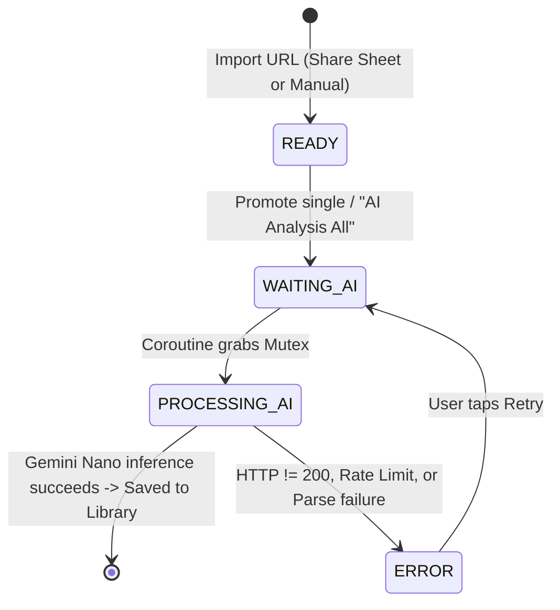
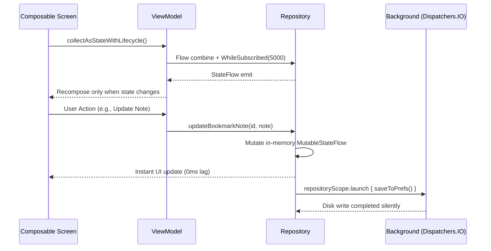

# Data Models, State Flows, & Persistence Interfaces

This document specifies all core domain models, state transition machines, serialization schemas, and reactive data streams used throughout Tidilo.

---

## 1. Domain Data Models

### 1.1 `BookmarkItem` & `Tag`
Located in `ui/screens/library/BookmarkItem.kt`:

```kotlin
@Immutable
data class BookmarkItem(
    val id: String = UUID.randomUUID().toString(),
    val title: String,
    val url: String,
    val description: String,
    val tag: Tag = Tag(),
    val createdAt: Long = System.currentTimeMillis(),
    val updatedAt: Long = System.currentTimeMillis(),
    val note: String = "",
    val isNsfw: Boolean = false,
    val isAiSkipped: Boolean = false
)

@Immutable
data class Tag(
    val category: String? = DEFAULT_TAG,       // 1 of 7 Top-Level Categories, "None", or null (when AI is skipped)
    val subcategory: String? = DEFAULT_TAG,    // 1 of 11 Subcategories, "None", or null (when AI is skipped)
    val entities: List<String> = emptyList()   // Keyword strings
) {
    companion object {
        const val DEFAULT_TAG = "None"
        fun create(category: String?, subcategory: String?, entities: List<String> = emptyList()): Tag
        fun createEmpty(): Tag = Tag(category = null, subcategory = null, entities = emptyList())
    }
}
```

### 1.2 `TrashedBookmarkItem`
Located in `ui/screens/library/BookmarkItem.kt`:

```kotlin
@Immutable
data class TrashedBookmarkItem(
    val bookmark: BookmarkItem,
    val trashedAt: Long = System.currentTimeMillis()
)
```

#### Trash Retention & Lifecycle Rules
- **Physical Exclusion**: Trashed items are physically excluded from normal bookmarks list, search feeds, and category queries.
- **Persistence**: Serialized to `trashed_bookmarks_list` in `tidilo_bookmark_prefs.xml`.
- **Retention Period**: Kept for 30 days (`TRASH_RETENTION_MS = 30 * 24 * 60 * 60 * 1000L`). Expired items are purged on application launch (`purgeExpiredTrash()`).
- **Maximum Capacity**: Capped at 100 items (`MAX_TRASH_CAPACITY = 100`). When a 101st item is trashed, the oldest item (closest to the 30-day limit) is permanently deleted automatically.

#### Self-Repair Guarantee
If old or corrupted JSON data lacks valid category/subcategory tags, `BookmarkRepository.parseBookmarks` automatically restores them using fallback sample references, queue completion cache, or domain mapping rules to guarantee no item permanently remains `None`.

---

## 2. Taxonomy System

Located in `data/Taxonomy.kt`:

### 2.1 The 7 Top-Level Categories
| English ID | Japanese Label | Definition |
| :--- | :--- | :--- |
| `Article` | 記事 | Articles, blog posts, editorials, news, technical explainers, opinions. |
| `Media` | メディア | Illustrations, photos, video content, music, audiobooks (Pixiv, YouTube, Vimeo). |
| `Tool` | ツール | Web applications, utilities, SaaS, code repositories, productivity tools (GitHub, Figma). |
| `Commerce` | コマース | E-commerce, online shops, product sales, pricing pages (Amazon, online stores). |
| `Community` | コミュニティ | Social networks, forums, Q&A boards, online communities (X/Twitter, Reddit, Discord). |
| `Official` | 公式 | Official portals, corporate homepages, brand landings. |
| `Reference` | リファレンス | Technical documentation, API references, dictionaries, wikis, standards (MDN, Android Docs). |

### 2.2 The 11 Subcategories
| English ID | Japanese Label |
| :--- | :--- |
| `Tech` | テック |
| `Business` | ビジネス |
| `Society` | 社会 |
| `Life` | ライフ |
| `Food` | グルメ |
| `Travel` | 旅行 |
| `Game` | ゲーム |
| `Entertainment` | エンタメ |
| `Hobby` | 趣味 |
| `Adult` | 大人の嗜好 |
| `Education` | 教育 |

Both `Category` and `Subcategory` provide bidirectional resolution via `fromId(query)` matching against English IDs, Japanese labels, and localized name getters.

---

## 3. Import Task State Machine & Models

Located in `data/ImportTask.kt`:

```kotlin
enum class TaskStatus {
    PROCESSING_AI, // Active inference running on Gemini Nano
    WAITING_AI,    // Waiting in Processing group for AICore execution slot
    READY,         // URL parsed and ready for AI analysis (share sheet or '+' button)
    COMPLETED,     // Finished tagging and saved into BookmarkRepository
    ERROR          // Failed due to rate limit, non-200 HTTP response, or parse failure
}

@Immutable
data class ImportTask(
    val id: String = UUID.randomUUID().toString(),
    val url: String,
    val title: String,
    val status: TaskStatus = TaskStatus.READY,
    val statusText: String = "",
    val errorMessage: String? = null,
    val assignedTags: List<String> = emptyList(),
    val createdAt: Long = System.currentTimeMillis(),
    val isNsfw: Boolean = false,
    val siteName: String = "",
    val description: String = "",
    val bodySnippet: String = ""
)
```

### 3.1 State Transition Lifecycle



---

## 4. Web Page Analysis Models

Located in `parser/WebPageData.kt`:

- `ParsedWebPage`: Comprehensive snapshot including `requestedUrl`, `finalUrl`, `resolvedUrl` (unwrapped Google share link), `statusCode`, `ogpTags`, `twitterTags`, `standardMetaTags`, `jsonLdList`, `h1List`, `h2List`, `readabilityArticle`, and `jsoupBodyText`.
- `WebMetaTag`: Generic key-value wrapper for meta attributes (`charset`, `name`, `property`, `http-equiv`, `itemprop`).
- `JsonLdItem`: Structured Schema.org entity metadata.
- `ExtractedArticle`: Cleaned article content from Mozilla Readability algorithm (`title`, `byline`, `excerpt`, `textContent`, `charCount`).

---

## 5. Gemini Generation Configuration Model

Located in `ui/screens/settings/GenerateContentRequestViewModel.kt`:

Controls runtime LLM generation options passed to `com.google.mlkit.genai.prompt.generateContentRequest`:
- `cachedContextName` (`String`, default `""` / disabled)
- `candidateCount` (`Int`, default `1`, enabled)
- `enableThinking` (`Boolean`, default `false` / disabled)
- `maxOutputTokens` (`Int`, default `4096`, disabled; overridden to `256` in tagging pipeline)
- `seed` (`Int`, default `0` / disabled)
- `temperature` (`Float`, range `0.0f..1.0f` in `0.1` steps, default `0.0f`, enabled)
- `topK` (`Int`, default `3` / disabled)

---

## 6. Persistence & Serialization Schemas

All persistence is managed via **Room Database** (`AppDatabase` v3) for robust relational and high-volume data, complemented by Android `SharedPreferences` for user configurations and transient search history:

1. **Room Database (`AppDatabase`)**:
   - **`bookmarks` table (`BookmarkEntity`)**: Managed by `BookmarkDao`, storing bookmarked items with indexed URL and creation timestamp.
   - **`import_tasks` table (`ImportTaskEntity`)**: Managed by `ImportTaskDao`, storing processing, ready, and error tasks with reactive `Flow<List<ImportTaskEntity>>` observation and status index.
   - **Single Source of Truth & Concurrency**: Room DB serves as the authoritative source of truth for all business operations, state promotions, and AI execution loops (`executeTaskAiAnalysis`). UI StateFlows (`_readyTasks`, `_processingTasks`, `_errorTasks`) are read-only observers of Room. Querying Room directly within `executionMutex.withLock` eliminates race conditions where asynchronous Flow emissions could otherwise lag behind immediate execution checks.
   - **Legacy Migration**: On initial launch of v3, existing task data in legacy `tidilo_queue_prefs` is imported into Room automatically and cleared.
2. **`tidilo_library_prefs` (`search_history`)**:
   Array of up to 10 strings representing complete queries, ordered latest-first.
3. **`tidilo_app_config_prefs`**:
   Application language, NSFW visibility toggle, AICore fallback mode, and auto-run settings.

---

## 7. Reactive StateFlow Architecture



---

## 8. Domain Policy & NSFW Architecture

### 8.1 `DomainPolicyManager`
Located in `data/DomainPolicyManager.kt`:
- **Persistence**: Persisted to `domain_policies.json` in `filesDir`.
- **Policy Record**: `DomainPolicy(domain: String, isNsfw: Boolean, displayName: String = "")`.
- **Display Name (`og:site_name`)**: Extracted from page HTML meta tags (`og:site_name`) during web page parsing or favicon discovery (`DomainIconManager.findHtmlIconUrls`), and stored as the human-readable display name for the domain.
- **Auto-Registration**: When new domains are enqueued or bookmarked, they are automatically registered with `isNsfw = false` and their display name if available.
- **Domain Verification**: Checked domains are designated as NSFW domains. Any bookmark from a checked domain is tagged as `isNsfw = true`.

### 8.2 NSFW Detection Signals (`WebPageParser.kt`)
Web page fetching uses Desktop Chrome User-Agent (`Windows NT 10.0; Win64; x64`, `sec-ch-ua-mobile: ?0`) to ensure platforms like Pixiv return complete desktop SSR HTML with standard metadata rather than stripped mobile touch SPAs. Programmatic detection extracts:
1. **Domain NSFW Policy (`DomainPolicyManager.isNsfwDomain(domain)`)**: If designated as NSFW in domain management, NSFW is unconditionally granted (`isNsfwSignal = true`) regardless of tags or metadata.
2. **Title / OGP Title Keywords**: `"R-18"`, `"R18"`, `"18禁"`, `"成人向け"`, `"成年コミック"`
3. **Meta Rating Standards (`<meta name="rating">`)**: `"R-18"`, `"R18"`, `"18+"`, `"RTA-5042-1996-1400-1577-RTA"`, `"adult"`, `"mature"`
4. **Schema.org / JSON-LD Properties**:
   - `isFamilyFriendly: false`
   - `contentRating`: `"R18"`, `"R-18"`, `"18+"`
   - `typicalAgeRange`: `"18+"`

### 8.3 Display Control & Dynamic Count Aggregation
- **Global Toggle**: `AppConfig.isNsfwContentVisible` (persisted in `tidilo_app_config_prefs`).
- **Reactive Filter**: `LibraryViewModel.bookmarks` combines `BookmarkRepository.bookmarks` with `AppConfig.isNsfwContentVisible`. When toggled OFF, NSFW bookmarks are completely excluded from `LibraryScreen`, `SearchScreen`, and category/entity counts in `TagSelectionScreen`.
- **Visual Badge**: Both `BookmarkCard` and `BookmarkDetailScreen` render a prominent `NSFW` pill chip beside the `[category] > [subcategory]` breadcrumb when `bookmark.isNsfw == true`.

---

## 9. Library Filter & Domain Grouping Models

Located in `ui/screens/library/DomainCard.kt` and `ui/screens/library/LibraryViewModel.kt`:

### 9.1 `LibraryFilterMode`
```kotlin
enum class LibraryFilterMode {
    NEWEST_FIRST,
    DOMAIN
}
```
Persisted in `tidilo_library_prefs.xml` under key `library_filter_mode`.

### 9.2 `DomainGroupItem`
```kotlin
@Immutable
data class DomainGroupItem(
    val domain: String,
    val displayName: String,
    val count: Int
)
```
- **Sorting Rule**: Sorted by `displayName` (fallback to `domain` if empty). ASCII alphanumeric (A–Z, 0–9) characters are ordered first, followed by Japanese kana/kanji ordered via `Collator.getInstance(Locale.JAPANESE)`.

