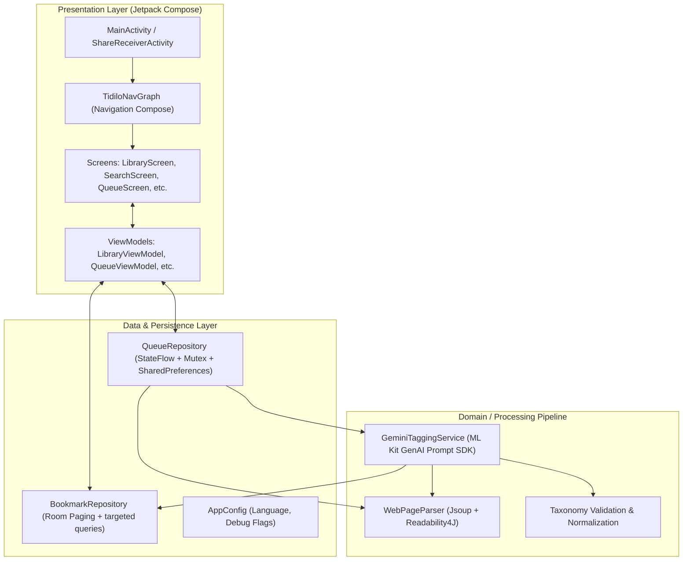

# Architecture Overview & Application Specification

## 1. Application Overview

**Tidilo** is a next-generation Android bookmarking and personal knowledge management application powered by on-device AI.  
Instead of manual folder sorting or manual tagging, Tidilo leverages Google's **Gemini Nano** foundation model running locally via the Android system **AICore** service. When a user shares a URL from a web browser or enqueues a link within the app, Tidilo scrapes the page, parses semantic metadata (OGP, meta tags, Mozilla Readability article body), resolves wrappers or shortened links, and invokes Gemini Nano on-device to automatically:
1. Synthesize an objective, one-sentence summary (in Japanese or English depending on user settings).
2. Classify the content into one of **7 Top-Level Categories** (Article, Media, Tool, Commerce, Community, Official, Reference).
3. Classify into one of **11 Subcategories** (Tech, Business, Society, Life, Food, Travel, Game, Entertainment, Hobby, Adult, Education).
4. Extract 2 to 10 canonical **Entity Keywords** (tools, brand names, technologies, creative works), strictly filtering noise like years, buzzwords, or generic modifiers.
5. Save the enriched bookmark into the user's permanent, searchable local library.

---

## 2. Core Architectural Patterns

RSS/Atom scheduling and XML bookkeeping use WorkManager, while manual and RSS imports share article HTML acquisition and preparation. XML-only registration precedes an initial-fetch choice. Direct saves prepared HTML metadata; capped RSS Ready tasks leave inference to the existing foreground worker. Feed XML failures disable the affected subscription with a persistent card explanation. Library source filters separate manual and RSS articles while Search and Summary include both. See [RSS and Atom Subscriptions](rss.md) for scheduling, Wi-Fi policy, receipts, retention, and lifecycle behavior.

Tidilo is built with modern **Android Clean Architecture** and **Unidirectional Data Flow (UDF)** principles using 100% Jetpack Compose and Kotlin Coroutines/Flow.

### 2.1 Unidirectional Data Flow (UDF)
- **State flows down**: Bookmark results use Room-backed Paging with finite page retention. Details observe a single ID; SQL aggregates supply domain/tag counts. ViewModels switch query generations before caching them. Compose collects pages with `collectAsLazyPagingItems()` and other state with `collectAsStateWithLifecycle()`.
- **Events flow up**: User interactions (taps, text input, chip selections) trigger ViewModel functions (`enqueueUrl`, `onSearchQueryChanged`, `updateBookmarkNote`), which delegate mutations to repositories or background services.

### 2.2 Offline-First & Local Storage (Room SQLite)
- Bookmark and trash records are persisted in a robust local SQLite database via AndroidX Room (`AppDatabase`, `BookmarkEntity`, `TrashedBookmarkEntity`).
- Indexed queries on URL, creation timestamp, category, subcategory, NSFW, and domain support targeted reads; transactions preserve durable write integrity. Performance evidence and limitations are recorded in `issue81-progress.md`.
- Room is the source of truth. Writes are awaited by ID/domain; Room invalidation refreshes Paging and aggregate observers. Active bookmarks are never cached as an unbounded application-wide list.
- An automatic migration bridge on startup safely ingests legacy `SharedPreferences` JSON caches into Room on first launch with an empty database.
- Disposable OG previews remain in `cacheDir/og_images`. Imports and grid cards share exact-image recovery with four concurrent workers, reference-counted cancellation, generation-safe clearing, and failure backoff. See [Bookmark Preview Cache](og_image_cache.md).
- Domain icons recover on display through an independent four-worker pipeline shared with imports. Startup retains policy synchronization and disk preload without network backfill. Candidate resolution short-circuits by priority; permanent absence markers expire after 14 days and transient failures back off for 60 seconds. See [Domain Icon Recovery](domain_icon_cache.md).

### 2.3 On-Device GenAI (AICore & Gemini Nano)
- Powered by `com.google.mlkit:genai-prompt:1.0.0-beta2`.
- Direct communication with the Android OS AICore system service without cloud round-trips, ensuring zero bandwidth consumption, ultra-low latency, and total user privacy.
- Strict token budgeting: requests configure `maxOutputTokens = 256` to ensure optimal throughput and instant inference.

---

## 3. Target Environment & Runtime Constraints

| Specification | Target / Requirement | Rationale |
| :--- | :--- | :--- |
| **Minimum SDK** | `minSdk 34` (Android 14) | Required for hardware-accelerated AICore and Gemini Nano system service availability. |
| **Compile & Target SDK** | `compileSdk 37` (Android 17), `targetSdk 36` (Android 16) | Full support for modern edge-to-edge system insets and Predictive Back gestures. |
| **JVM Target** | Java 21 | Modern language features, pattern matching, optimized runtime compilation. |
| **Target Hardware** | Devices that support the **Prompt API** of the ML Kit GenAI API. | Hardware NPU capability for real-time on-device LLM inference. |
| **Form Factor** | Modern Android smartphones & foldable devices | Edge-to-edge layout, responsive container width (75% floating bar), dynamic system bars. |
